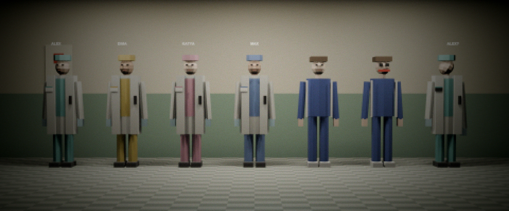
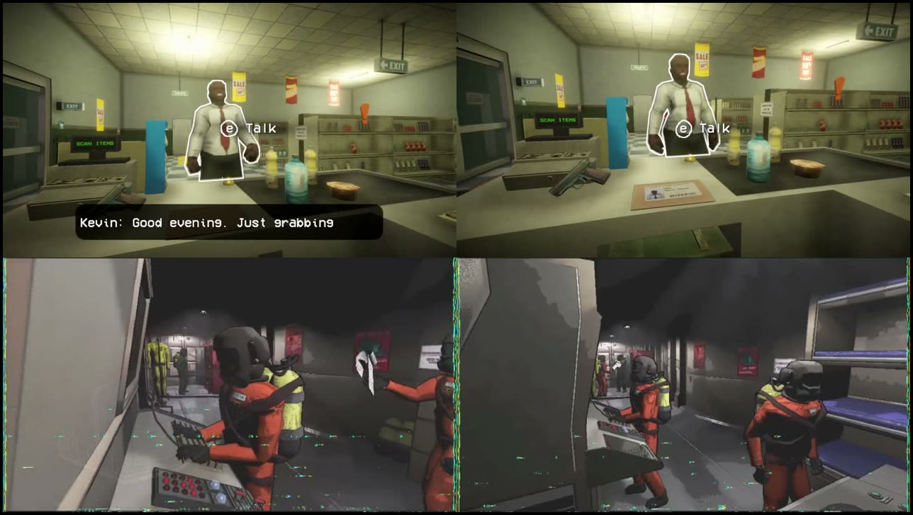

# Персонажи CLINIC 13

Дата: 2026-11-21. Стиль: **Shift At Midnight** (основа), чуть-чуть **Lethal Company** (читаемые силуэты в форме).

## Концепт-блокаут

`concept/characters_lineup.png` — рендер Blender с постобработкой «под Shift»:
- уменьшение с фильтром «ближайший пиксель»;
- зерно;
- виньетка.

Исходник: `concept/characters_lineup_raw.blend`.

Это **блокаут из примитивов**, не финальные модели. Он показывает силуэты, цвета, пропорции и признаки.

Слева направо:

| № | Кто | Что показывает |
|---|---|---|
| 1–4 | Врачи ALEX, DIMA, KATYA, MAX | Белый халат, цветная хирургичка и шапочка (бирюза, горчица, розовый, синий), маска на шее, бейдж с ником, фонарик в кармане, латексные перчатки |
| 5 | Пациент | Человек с улицы 1998 года: спортивный костюм с лампасами, кроссовки |
| 6 | Двойник пациента | Тот же костюм. Глаза — чёрные провалы, улыбка до ушей, голова наклонена |
| 7 | Двойник коллеги «ALEX?» | Цвет и форма как у ALEX, но лицо гладкое, бейдж чёрный (пустой), одна рука длиннее, голова наклонена |

## Цель по качеству моделей

- **Сверху, Shift.** NPC — простые лоуполи-люди почти реальных пропорций: матовые текстуры 128–256 px с point-фильтром, лицо нарисовано текстурой, крупная читаемая одежда.
- **Снизу, Lethal.** Команда в одинаковой яркой форме, громоздкий силуэт, видно издалека в темноте.

## Технические рамки

| Что | Норма |
|---|---|
| Врач | 2,5–4 тыс. треугольников, 1 материал, атлас 256 px, point-фильтр |
| Пациент | 2–3,5 тыс. треугольников |
| Телосложения пациентов | 3 (среднее, полное, худое/высокое) |
| Модульные части пациента | Головы, волосы, верх, низ, обувь, аксессуары |
| Двойники | Модульные «признаки» (родинка, зубы, глаза, лишний палец, тень) по правилу несовпадения (GDD §6.2) |
| Скелет | Mixamo-совместимый. Ходьба, бег, присед, перенос, толчок, нокаут, подъём, сидеть на кровати, «неправильно сесть» (двойник) |
| Лицо | Текстура + 2–3 сменные «маски» эмоций. Без лицевого рига |
| FP-руки | Отдельный меш: перчатки, рукава халата |
| Свет и материал | Matte Lit (без блеска), запечённый свет, сильный AO, чёрный туман |

## Детали формы врача

- **Хирургичка** — цвет игрока:
  - бирюзовый `#2E7373`;
  - горчичный `#94761F`;
  - розовый `#99526B`;
  - синий `#2E4280`.

  Приглушённые цвета, как у Shift, не неон.
- **Халат:** застиранный белый `#B3B5AB`, распахнут, на спине номер «13».
- **Шапочка** под цвет хирургички, **маска** на шее.
- **Бейдж** с полароидом игрока и ником, крупный: главный признак подменыша.
- **Позже, косметика:** шапки, очки, халат с пятнами, бейджи.

## Пациенты 1998 года (набор MVP)

- **Одежда:** спортивный костюм с лампасами, кожанка, свитер с оленями, халат-пижама, рабочая спецовка, пальто с меховым воротником.
- **Аксессуары:** кепка, ушанка, очки, авоська, пакет «Marlboro», гипс.
- **«Странные, но нормальные»:** очень большие глаза, швы, перевязанная голова. Одинаковы во всех каналах проверки.
