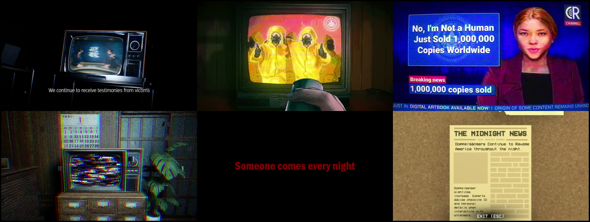
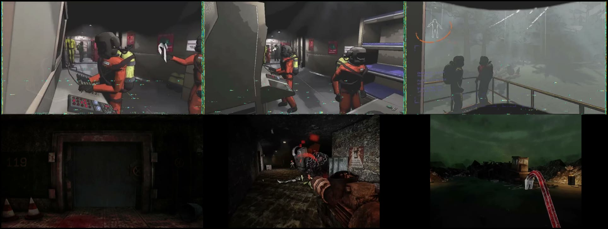
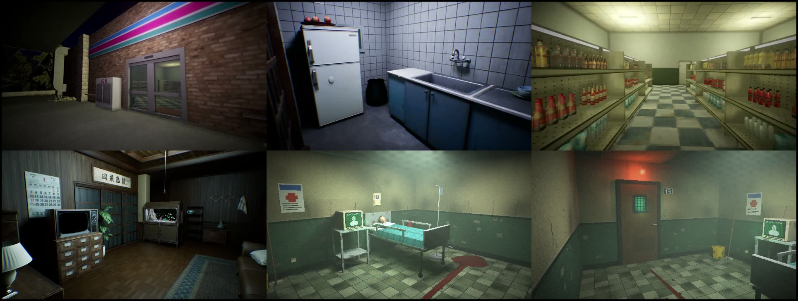
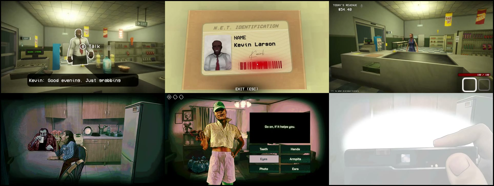
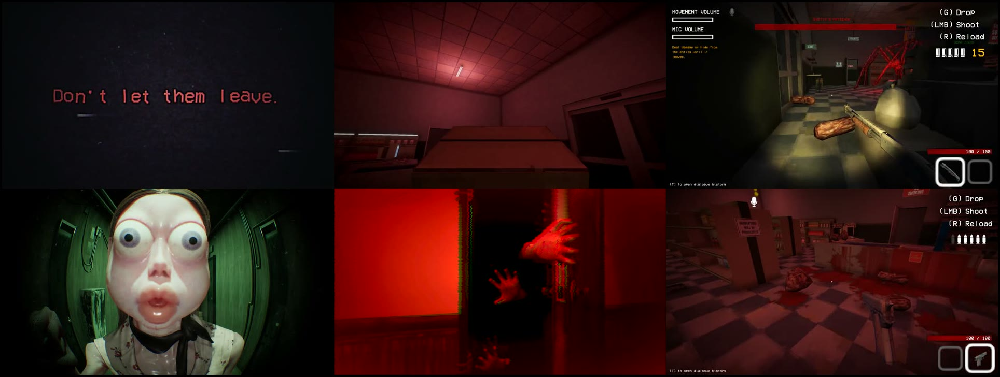

# CLINIC 13: концепт MVP и трейлер «новости → смена → хаос»

Дата: 2026-11-21. Заменяет раскадровку `docs/trailer/TRAILER_REFERENCE_ANALYSIS.md` §4.

Решения Alex:
- лиц и вебкамер друзей в трейлере нет;
- открытие — новости по ТВ с багами, как у Who's at the door и No, I'm not a Human;
- дальше спокойная смена, приём пациента в хоррор-стиле;
- затем начинается дичь по концепту Shift At Midnight и КЛЕТИ.

Доски референсов (кадры из скачанных трейлеров, только для внутреннего использования): `references/boards/`.

---

## 1. Короткие трейлеры: что важно для нас

| Трейлер | Длина | Средний план | Пик (склеек за 5 с) | Как открывается |
|---|---|---|---|---|
| No, I'm not a Human — Language | 42,5 с | 0,8 с | 15 на 35 с | Гость в ночном видении → новости CR Channel с бегущей строкой |
| Lethal Company | 52,3 с | 1,6 с | 9 на 0 с | Плакат «THE COMPANY IS HIRING!» |
| Who's at the door — Game | 55,7 с | 2,7 с | 4 | **Новости по старому ТВ 15 с одним планом**, субтитры |
| Who's at the door — Teaser | 63,9 с | 3,0 с | 6 | Тихий обход квартиры, потом лицо в глазок |
| Shift — Release Date | 67 с | 1,4 с | 8 на 55 с | Сразу геймплей с монстром |
| CRACK — Launch | 69,9 с | 1,4 с | 7 на 5 с | Холодное открытие → логотип на 6 с |
| Shift — Wishlist | 72,5 с | 1,1 с | 24 на 60 с | Стримеры → газета → смена |

**Выводы:**
- [вывод] Длина нашего трейлера — **60 с**: короткие трейлеры укладываются в 42–72 с.
- [факт] У Who's at the door новости идут 15 с одним планом. [вывод] Для Steam это долго: у нас новости ≤ 10 с, и баги начинаются уже на 3-й секунде, иначе зритель уйдёт.
- [факт] No, I'm not a Human показывает новости как настоящий канал: логотип в углу, плашка «Breaking news», бегущая строка. [вывод] Это сразу читается как «мир сломан».

*Сверху: Who's at the door (ТВ в тёмной комнате + субтитры), No, I'm not a Human (рука с пультом, ТВ), No, I'm not a Human (студия новостей с бегущей строкой). Снизу: Who's at the door (глитч ТВ), Who's at the door (красный текст на чёрном), Shift (газета на доске).*

---

## 2. Трейлер CLINIC 13, 60 с

Кривая: **тихо и смешно → «что-то не так» → красный хаос → тишина → логотип → стингер.**

| Время | Что в кадре | Темп и звук | Откуда приём |
|---|---|---|---|
| **0–2 с** | Тёмная комната персонала. Щелчок, CRT включается сам | Тишина, писк ТВ | Who's at the door |
| **2–10 с** | **Новости «ГОРОД-13», 1998.** Диктор, логотип канала, плашка «СРОЧНО», бегущая строка. Субтитры: «…за неделю пропали ещё четверо…» → «Частная клиника №13 возобновляет ночной приём» → «Горздрав: поводов для паники нет». Глитчи: на 2–3 кадра у диктора **не то лицо**, картинка рвётся | 3–4 плана. Тихий гул, голос диктора | No, I'm not a Human, Who's at the door |
| **10–11 с** | Помехи → логотип CLINIC 13 вспышкой | Удар | CRACK |
| **11–24 с** | **Нормальная смена**, тёплый свет. Окно регистратуры, пациент: «Добрый вечер, доктор». Полароид проявляется. Чек-лист «Проверь». «ПРИНЯТЬ». Каталка по коридору, друг катит друга. Монитор «ЖАР» → таблетки → «ВЫПИСАН». Морозный спрей в друга | Планы 1,5–2 с. Музыка-шкатулка, комедийные звуки, рация | Shift, Lethal |
| **24–32 с** | **«Что-то не так».** Родинка на фото с другой стороны. Пациент повторяет фразу врача. CCTV: выписанный лежит и смотрит в камеру. Лампа мигает. Под кроватью шевелятся пальцы | Планы 1 с, музыка проседает, громче дыхание | Not a Human, Shift |
| **32–34 с** | ТВ в комнате персонала сам включается: на экране **регистратура в прямом эфире**, в кадре стоят наши врачи. Чёрный, печатается: **«ОНИ УЧАТСЯ У ВАС.»** | Тишина + щелчки машинки | Shift (перелом) |
| **34–48 с** | **Красный аварийный свет**, корпус заблокирован. Двойник садится в кровати неправильно, погоня по коридору. Подкроватник утаскивает друга, второй тянет его за руку. Двери палат хлопают. Огнетушитель в лицо монстру. Разрядник. Каталка-таран | 6–10 склеек за 5 с, нарастающий бит | Shift, КЛЕТЬ |
| **48–52 с** | **Залп** 20+ склеек по 0,1–0,2 с. Скример Blink: лицо двойника в окне регистратуры | Пик громкости −11…−8 LUFS | Shift Wishlist, Not a Human |
| **52–55 с** | Чёрный, тишина | −40 LUFS | Lethal, Shift |
| **55–59 с** | Логотип CLINIC 13 (глитч, красный крест) + «Кооп 1–4» + «Добавь в желаемое» | Низкий гул | все |
| **59–63 с** | **Стингер:** у двери стоит врач с ником друга на бейдже. Рация: «Я вообще на складе». Двойник поворачивает голову. Срез | Голос в рации | наш гэг |

**Вариант стингера Б:** ТВ в комнате персонала, новости. Диктор в белом халате говорит голосом друга: «Доброй ночи, коллеги». Выбрать по тест-показу.

**Тексты (RU / EN), черновик:**
- «За неделю в городе пропали ещё четыре человека» / «Four more people went missing this week»
- «Клиника №13 возобновляет ночной приём» / «Clinic No. 13 resumes night admissions»
- «Горздрав: поводов для паники нет» / «Health Department: no reason to panic»
- Перелом: «ОНИ УЧАТСЯ У ВАС.» / «THEY LEARN FROM YOU.»

---

## 3. Что должно быть в MVP

MVP — одна смена ≈15 мин в одном корпусе на 1–4 игроков. В ней естественно случается каждый кадр трейлера. Всё, чего нет ниже, — после страницы Steam.

### 3.1. История и подача

**Лор MVP (сжатый GDD §3):**
- 1998 год, провинциальный город, люди пропадают.
- Частная клиника №13 закрыта 13 лет назад и снова нанимает ночных врачей: платят подозрительно много, выходить из корпуса с 00:00 до 06:00 запрещено.
- Правда для поздних смен: «Протокол 13», копии людей учатся, наблюдая за пациентами и врачами. Отсюда строка перелома «Они учатся у вас».

**Как подаём в MVP** (без кат-сцен, всё внутри игры):
1. **ТВ-новости в комнате персонала** перед каждой сменой, 30–40 с, можно пропустить. Это настоящая фича игры, поэтому кадр трейлера честный. Сюжет движется выпусками: пропажи → клиника открыта → «очевидцы видели двойников» → эфир прерывается.
2. **Приказ по клинике** на доске у входа: 3 правила, «Администрация благодарит за сотрудничество».
3. **ТВ-аномалия посреди смены:** в 03:00 ТВ включается сам и показывает регистратуру в прямом эфире с лишним человеком в кадре.

**Каналы для MVP:** 1 выпуск новостей + 1 вариант с глитчем + эфир-аномалия.

### 3.2. Игроки: кто и как выглядят

Врачи ночной смены, вид от первого лица, у каждого свой цвет.

| Что | Решение | Зачем |
|---|---|---|
| Силуэт | Белый халат поверх хирургички, медицинская шапочка, маска на шее | Читается в темноте и в PSX-разрешении |
| Цвет игрока | Хирургичка и шапочка: бирюзовая, горчичная, розовая, синяя | Как оранжевые костюмы Lethal: друга видно издалека. Двойнику коллеги нужно копировать цвет |
| Бейдж | Крупный, на груди, с ником игрока и полароидом | Главный признак подменыша: пустой бейдж или чужое фото |
| Лицо | Простое PSX-лицо, слегка комичное; 4 пресета | Смешно в кадре, дёшево в моделинге |
| Руки (FP) | Латексные перчатки, в руках фонарик или предмет | Крупные кадры для трейлера: полароид, спрей, швабра |
| Анимации | Mixamo: ходьба, бег, присед, перенос, толчок, «нокаут», подъём | Минимальный набор для кадров |
| Косметика (позже) | Шапки, бейджи, халаты | После MVP |

*Сверху: Lethal Company — одинаковые костюмы, команда видна в одном кадре. Снизу: КЛЕТЬ — старт смены у лифта, игрок в темноте, выход на поверхность.*

### 3.3. Как игроки взаимодействуют

Правило: каждое взаимодействие либо **помогает**, либо **смешно мешает**, и всё это ловится в кадр.

**Помогают:**
- **Рация + позиционный голос.** Рядом слышно в 3D, в рации — с шипением. Перекличка — главная проверка «это точно ты?».
- **Передать полароид** коллеге: один стоит у окна, другой сверяет с пациентом в палате.
- **Каталка:** один толкает, на ней лежит пациент или друг.
- **Держать дверь**, пока второй несёт разрядник.
- **Светить под кровать**, пока второй моет пол.
- **Поднять друга** после нокаута нашатырём.

**Смешно мешают** (у каждого кулдаун, без урона):
- **Морозный спрей** — друг застывает на 2–3 с.
- **Лужа крови** — друг скользит, если никто не помыл.
- **Каталка-таран** — сбивает с ног.
- **Запереть в кладовой** — аварийная ручка изнутри через 5 с.
- **Пена огнетушителя** в лицо.

**Пациенты реагируют на голос** по громкости: «Не кричите, доктор». Распознавания речи нет.

**Роли без классов:** стойка (проверка), бегун (склад и палаты), охрана (CCTV и перекличка).

### 3.4. Больница MVP

Компактный корпус из GDD §13, путь палата ↔ склад 10–20 с.

| Зона | Что в ней | Кадр трейлера |
|---|---|---|
| Комната персонала | CRT-ТВ, диван, доска «Приказ», шкафчики, лобби | Новости 0–10 с, эфир-аномалия, стингер Б |
| Регистратура | Окно со стеклом, лампа, полароид-принтер, монитор «камера сзади», журнал | Приём 11–24 с, скример в окне |
| Коридор | Длинный, люминесцентные лампы, табло палат, указатели | Каталка, погоня, красный свет |
| Палаты 1–3 | Кровать, CRT-монитор диагноза, карта у кровати, ширма | Двойник садится, подкроватник |
| Изолятор | Стеклянная палата, 1 место | Пациент в стекле |
| Склад | Стеллажи с крупными этикетками | «Я на складе» |
| Охрана | 2–4 CCTV-монитора, щиток | «Выписанный лежит» |

**Вид:**
- Частная клиника 1998 года: линолеум и кафель, грязно-зелёные стены снизу, бежевые сверху, деревянная стойка, CRT, плакаты-пародии Минздрава вроде «Мойте руки. Сверяйте лица.».
- **Две палитры, как у Shift:**
  - спокойная — тёплый жёлтый в палатах и холодный зелёно-синий в коридоре;
  - тревога — **красный аварийный** + стробы.
- CCTV — зелёное ч/б.
- PSX: 640×360, дизеринг, snap, чёрный туман, сильный AO.
- База — наш зонд v3, он уже в этом направлении.

*Сверху: Shift — магазин ночью снаружи; Who's at the door — кафель и холодный свет; Shift — пустой торговый зал с люминесцентными лампами. Снизу: Who's at the door — жилая комната 90-х с ТВ; **наш зонд v3** — палата и дверь (PSX).*

### 3.5. Пациенты и проверка

- **3 телосложения** + сменные головы, волосы и одежда; **6–8 признаков несовпадения**: родинка, пальцы, зубы, тень, обувь, имя, бейдж, повтор фраз.
- **Правило:** «Странные — не страшные. Страшно, когда не совпадает».
- **Цикл:** окно → разговор (E: «Что болит?», «Как зовут?») → полароид проявляется 2 с → камера сзади → «Принять / Отказать / Изолятор» → палата → монитор → 1–2 предмета → «ВЫПИСАН».
- **UI крупно для трейлера:** чек-лист «Проверь: ЛИЦО / РУКИ / ТЕНЬ / ГОЛОС», карта пациента, штамп.
- **Болезни MVP (4):** жар → таблетки, кровотечение → бинт, перелом → морозный спрей, обезвоживание → капельница.

*Сверху: Shift — диалог-субтитр у кассы, удостоверение крупно, вид на стойку. Снизу: No, I'm not a Human — гости в доме, меню осмотра (зубы, руки, глаза, фото), вспышка фотоаппарата.*

### 3.6. Аномалии MVP

| Аномалия | Предвестник | Раскрытие | Контрмера | Кадр |
|---|---|---|---|---|
| **Двойник пациента** | Несовпадение на фото и в журнале, искажённый диагноз «██ ███», повтор фраз | Садится в кровати неправильно, шея гнётся, погоня по коридору | Изолятор, запереть палату, разрядник | 24–52 с |
| **Подкроватник** | Шорох, пальцы из-под кровати | Хватает за ногу, утаскивает | Посветить фонарём, морозный спрей | 30, 40 с |
| **«Камера врёт»** | — | На CCTV то, чего нет: выписанный лежит, лишний врач | Сходить проверить, починить камеру | 28 с |
| **Аварийный режим** | Мигание ламп, щиток искрит | Красный свет, корпус заблокирован до 06:00 | Щиток, держаться вместе | 34–52 с |
| **ТВ-эфир** | ТВ включается сам | Регистратура в прямом эфире, лишний человек | — (страх и сюжет) | 32 с |
| **Подменыш коллеги** | Пустой бейдж, рация шипит рядом, нет отражения в стекле | Стоит у двери с ником друга | Перекличка по рации, свет | 59 с |

Каждая угроза идёт по шаблону `Dormant → Telegraph ≥5 с → Active → Attack → Cooldown`. Директор: 1 охотник одновременно, крупный скример не чаще раза в 3–4 мин.

*Сверху: Shift — печатная строка на чёрном, красный аварийный свет, монстр в торговом зале. Снизу: Who's at the door — лицо в глазок, красные руки из двери; Shift — кровь в красном свете.*

---

## 4. Как подготовить правильнее всего

Порядок не меняется: **сначала работающая игра, потом съёмка.** Новое относительно плана ред. 2:

1. **T0 (сейчас):** ты утверждаешь этот документ — раскадровку §2, игроков §3.2, MVP §3.
2. **M0–M1:** как в плане, плюс **4 цветных врача** с бейджами в коопе.
3. **M2:** петля пациента, плюс **комната персонала с ТВ** и проигрыватель «выпусков» (видео-текстура или 3D-студия диктора, глитч-шейдер, субтитры).
4. **M3:** аномалии §3.6, включая ТВ-эфир и красный режим.
5. **M4:** арт локаций §3.4 и **студия новостей**: лоуполи-диктор, логотип канала «ГОРОД-13», плашки и бегущая строка.
6. **M5:** съёмка. Новости снимаем в движке через Unity Recorder, геймплей — в коопе с друзьями плюс режим режиссёра.

**Ты собираешь** (обновлённый `docs/trailer/CAPTURE_CHECKLIST.md`):
- 2–3 друга для сессий, вебкамеры не нужны;
- голос диктора: ровный «телевизионный» голос на RU и EN — твой, друга или актёра (≈ 20 с текста);
- голос друга для реплики «Я на складе»;
- музыка с нарастанием и обрывом, звуки ТВ (щелчок, писк, помехи);
- название канала и газеты — или берём мои черновики.
